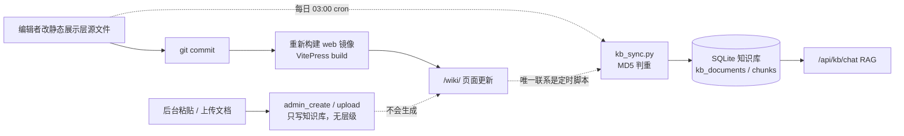
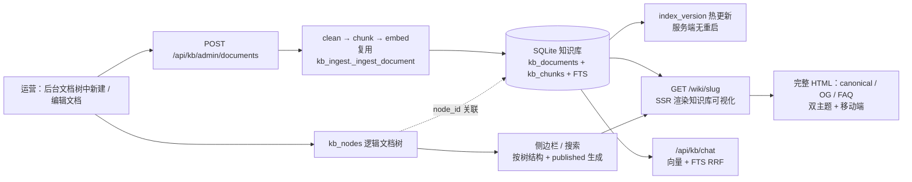

# 知识库与知识库可视化（Wiki）打通改造方案

> 状态：方案草案（供评审）。分析对象是 2026-11-27 的 `dev` 分支代码，2026-11-28 按「文档树 + 术语统一」要求修订。
> 目标：让「新增一篇文档」成为**一次操作**——后台在文档树里录入即完成入库、切片、Embedding，面向用户的知识库可视化页面即时更新。
> 前提：允许更换整个展示层框架（题设条件）；方案 A 为推荐方案。
> 范围：本期只有**一个知识库**，标题固定为「默认知识库」；不实现多知识库，也不做不同知识库之间的检索隔离。
> 配套：[存量数据迁移方案](./存量数据迁移方案.md)（上线前迁移）、[旧组件移除方案](./旧组件移除方案.md)（上线验证后清理）。

---

## 0. 术语约定（先统一口径）

本文及后续所有文档/代码/界面统一使用下列术语。**后台没有 wiki 概念，只有知识库。**

| 术语 | 定义 | 使用边界 |
| --- | --- | --- |
| **知识库（KB）** | 后台唯一的数据源与管理对象：文档树、正文、切片、向量、FTS、索引版本全部在知识库里 | 后台管理、API、数据库、代码命名一律用「知识库 / kb」 |
| **默认知识库** | 本期**唯一**的知识库，标题固定为此值；`kb_nodes` 只有一棵树，不建知识库表、不加 `kb_id` | 后台页面标题/面包屑显示；不提供新建/切换知识库入口 |
| **Wiki（知识库可视化）** | 面向用户的**只读展示层**，把知识库文档树渲染成可浏览网页 | 仅指对外展示形态与公开 URL 入口 `/wiki/`；后台不出现「wiki 文档 / wiki 同步 / wiki 来源」等说法 |
| **文档树** | 知识库内部的逻辑层级结构（目录节点 + 文档节点），存在数据库中 | 后台文件树 UI 与公开侧边栏都从它生成 |
| **目录节点** | 树中的容器，无正文，可嵌套 | 对应旧 `config.mts` 侧边栏的分组 / 折叠分组 |
| **文档节点** | 树中有正文的节点，对应 `kb_documents` 一行 | 对应旧侧边栏的可点击条目 |
| **现有静态展示层** | 改造前的 VitePress 站点（历史目录名 `wiki/`） | 只在描述现状/迁移时出现，不作为后台概念 |

> 现状描述里出现的 `wiki/` 目录、`source_type='wiki'`、`KB_WIKI_DIR` 等，都是**历史实现名**；改造后按 §5.2 清理。
> 公开站点的品牌标题（如「星穹旅驿 Wiki · 我的世界阵营生存服」）是**展示层文案**，与知识库名称「默认知识库」不是一回事；后台不因多库而改标题。

---

## 1. 结论先行

**推荐方案（A）：废弃 VitePress 静态站，把 SQLite 知识库提升为全站唯一数据源；在知识库里新增一张逻辑文档树表 `kb_nodes`，后台以文件树形式维护层级；展示层改为由 FastAPI 后端动态渲染（SSR）的知识库可视化。**

- 后台「新增/编辑文档」一次 API 调用内完成：正文落库 → 切片 → Embedding → FTS/向量索引热更新 → 可视化页面即时可访问。
- **层级关系存在知识库里，不靠文件**：目录/文档节点、父子关系、排序、发布状态全部是数据库行；后台用文件树 UI 维护（新建目录、拖拽排序/移动、重命名、软删除、发布切换）。
- 不再有 `kb_sync.py` 每日定时同步；不再有「改文件 → 重新构建前端镜像 → 等第二天 cron」的链路。
- RAG（智能客服）与知识库可视化消费**同一份正文、同一批切片、同一个版本号**——检索到的内容与用户看到的页面天然一致。
- 术语落地：后台/API/DB 不再有 wiki 概念；`wiki` 只作为面向用户的可视化入口 URL 与展示层代称保留。
- **范围锁定**：只有一个知识库，标题固定「默认知识库」；`kb_nodes` 是单棵树，**不引入 `kb_id` / 知识库表 / 多库检索隔离**——虽然树结构理论上可扩展，本期不做。

**本期非目标（明确不做）**

- 多知识库的创建 / 切换 / 删除，以及不同知识库之间的检索隔离或跨库检索；
- 按文件（md / git / CI 构建）管理文档（见 §4 方案 B）；
- 知识库粒度的权限隔离（沿用现有 `require_admin` 单一权限口径）。

为什么不保留 VitePress（依据见 §4）：它是**纯静态构建**，运行时不读数据库；要让它反映后台新增的文档，必须「写文件 → `npm run build` → 发版」，与「新增即上线」根本冲突，且 2C2G 生产机不能构建（见 §3.2 #2）。

---

## 2. 现状分析

### 2.1 两套系统的边界

| 维度 | 现有静态展示层（历史 `wiki/` 目录） | 知识库（后台） |
| --- | --- | --- |
| 数据源 | `wiki/**/*.md` 源文件（git 跟踪，19 篇） | SQLite `backend/data/*.db` 中 `kb_documents` / `kb_chunks` / `kb_chunks_fts` |
| 层级来源 | 手写死在 `wiki/.vitepress/config.mts` 的 `themeConfig.sidebar`（三大分区 + 固定条目） | **无层级概念**，后台只有扁平文档列表 |
| 内容形态 | Markdown 文件（含 frontmatter `description`、VitePress `:::` 容器、相对链接、图片） | 文档行 + 切片行（切片带 float32 向量 BLOB） |
| 产出 | `wiki/.vitepress/dist/` 静态 HTML，在 `web/Dockerfile` 的 `build-wiki` 阶段构建，nginx 在 `/wiki/` 提供 | `/api/kb/chat` SSE 问答；`/api/kb/admin/*` 管理接口 |
| SEO | `config.mts` 的 `head` + `transformHead` 在**构建期**写 canonical / OG / FAQPage JSON-LD | 无 |
| 修改入口 | 改 md 文件 → git commit → 重建 web 镜像 → 发布 | 后台粘贴 Markdown / 上传 PDF·DOCX·PPTX·MD·TXT（`admin-frontend/src/views/kb/list.vue`） |

关键差距：**层级关系现在只活在 `config.mts` 的侧边栏配置里，知识库自己完全不持有层级**——这正是后台无法用文件树维护的根因。

### 2.2 当前唯一的联系：`kb_sync.py` + 每日 cron

- `backend/kb_sync.py`：CLI 脚本，独立进程直写同一个 SQLite（WAL + busy_timeout）。
  - 扫描历史 `KB_WIKI_DIR` 下全部 `*.md`（排除 `node_modules/.vitepress/dist`），按相对路径为 `source_path`；
  - MD5 判重：无记录→新增；MD5 相同且 `status=ready`→跳过；MD5 不同→删旧切片/FTS/向量后重建；文件消失→`--prune` 删除；
  - 摄入后自增 `kb_settings.index_version`，服务端下次对话轻量比对版本号后重建内存向量索引（**不重启**，这是设计点，见 `docs/agents/kb.md`）。
- `backend/crontab`：`0 3 * * * root … python backend/kb_sync.py --incremental`，每日 03:00（北京时间）跑一次。
- 容器内历史 wiki 目录以**只读卷**挂到 `/app/wiki`（`docker-compose.yml`：`- ./wiki:/app/wiki:ro`），后端只能读、不能生成页面。

### 2.3 关键代码地图

| 关注点 | 文件 |
| --- | --- |
| 同步 CLI（改造后仅一次性迁移用） | `backend/kb_sync.py` |
| 切片 / Embedding（两调用方共用） | `backend/app/kb_ingest.py` |
| 知识库管理接口（文档 CRUD / 上传 / 重建） | `backend/app/kb.py`（`_ingest_document`、`admin_create/upload/delete/reindex_document`） |
| 内存向量索引 + 热更新 | `backend/app/kb_index.py` |
| 表结构 / 迁移 | `backend/app/database.py`（`KBDocument` / `KBChunk` / `KBSetting`） |
| 配置 | `backend/app/config.py`（模块级 `KB` 对象，启动期读 `.env`） |
| 现有展示层构建 / 服务 | `wiki/.vitepress/config.mts`、`web/Dockerfile`（`build-wiki`）、`web/nginx.conf` |
| 后台文档管理 UI | `admin-frontend/src/views/kb/list.vue` |
| 定时任务 | `backend/crontab` |

### 2.4 当前数据流



最关键的两条断边：
1. **后台新增（`H→I`）永远到不了可视化层（`D`）**——后台文档在用户侧不可见；
2. **展示层改动（`A`）到知识库（`F`）最长等 24 小时**，且必须有人记得跑脚本/发版。

---

## 3. 痛点与改造困难点

### 3.1 业务痛点（为什么要改）

1. **两套真相源**：可视化页面与知识库文档是两份独立数据，天然漂移；
2. **单向且延迟**：只有 `展示层 → 知识库` 一条同步，且 T+1；`知识库 → 展示层` 完全没有；
3. **新增文档不闭环**：后台上传/粘贴的文档只进知识库，用户在可视化层看不到；
4. **层级不可维护**：侧边栏层级写死在 `config.mts`，后台无法新增分组、调整顺序或移动文档；
5. **更新成本高**：改一个字也要「改文件 → 构建镜像 → 发版」；生产不能本机构建，必须走 Release；
6. **运维门槛**：`kb_sync.py` 是 SSH 上服务器跑的 CLI，运营无法自助完成整条链路。

### 3.2 技术困难点（改造时必须解决的约束）

| # | 困难点 | 说明 / 影响 |
| --- | --- | --- |
| 1 | **VitePress 静态本质** | 运行时不读 DB，无法「新增即上线」，也无法从知识库动态生成侧边栏；这是必须换框架的根本原因。 |
| 2 | **2C2G 不能服务器构建** | `docs/deployment.md`：生产只 `docker compose pull && up --no-build`，Vite 构建会 OOM。方案不能依赖「服务器现场 build」。 |
| 3 | **历史目录只读挂载** | `- ./wiki:/app/wiki:ro`，后端无法写文件；「后台写 md 文件」路线还要处理 git 工作树一致性——本方案不再考虑按文件管理，从根上避开。 |
| 4 | **SEO 依赖构建期注入** | canonical / OG / FAQPage JSON-LD 由 `transformHead` 写进静态 HTML（QQ/微信/搜索引擎抓取不执行 JS）。SSR 必须在**服务端**重新生成 head，否则 SEO 退化。 |
| 5 | **内容特性要保留** | frontmatter `description`、`:::` 容器、以 `/` 开头的站内链接、`/doc-image/` 图片、Heading 锚点/TOC；替换渲染管线时不能丢。 |
| 6 | **Embedding 是远端 API、有耗时与失败** | `kb_ingest.embed_documents` 走硅基流动 bge-m3（1–3s/篇），可能超时/维度不符；写入必须幂等、失败落 `status=failed` 且可重试（现有 `_ingest_document` 已具备，应复用）。 |
| 7 | **索引热更新不能退化** | `kb_settings.index_version` + 每轮对话轻量比对是明确设计点（见 `docs/agents/kb.md`）；不得改成「重启生效」。 |
| 8 | **检索与展示必须同版本** | RAG 命中的切片与可视化展示的正文若来自不同版本，会「答非所读」。必须共用同一 `kb_documents` 行与 `content_hash`。 |
| 9 | **层级变更不应触发 Embedding** | 拖拽排序/移动目录只改层级，不改正文；若层级塞在 `kb_documents` 里会无谓重算向量。层级必须与正文分表存储（见 §5.3）。 |
| 10 | **双 nginx 配置同步** | `web/nginx.conf` 与 `for-deploy/xqly-app.conf` 是同一规则的两份载体；改 `/wiki/` 代理必须两份同步，并保留 SSE 四件套、SPA fallback、legacy location。 |
| 11 | **主题 / 移动端规约** | 可视化页面与后台文件树 UI 必须适配浅/深双主题与窄屏（`AGENTS.md` 全局规约），不能写死色值。 |
| 12 | **历史数据迁移** | 19 篇存量 md 要一次性导入树，URL（`/for-new/quick-start/` 等）不能变，否则外链与收录失效；层级从 `config.mts` 还原。 |
| 13 | **单 worker / 并发写** | 限流与向量索引在进程内；后台多人编辑同一篇要有乐观锁（`revision`），避免互相覆盖。 |

---

## 4. 方案选型对比

| 方案 | 做法 | 「新增即上线」 | 层级可维护 | SEO | 构建/部署成本 | 与 RAG 一致性 | 评价 |
| --- | --- | --- | --- | --- | --- | --- | --- |
| **A. 知识库单一数据源 + 逻辑文档树 + 后端 SSR 可视化（推荐）** | 废弃 VitePress；新增 `kb_nodes` 树表；后台文件树 UI；FastAPI 从知识库动态渲染可视化 | ✅ 秒级 | ✅ 拖拽/移动/发布 | ✅ 服务端生成 head | 后端加 2 个 Python 依赖，去掉 `build-wiki` | ✅ 天然一致 | **最优**：消除分裂，层级入库，长期成本最低 |
| B. 保留 VitePress，后台树 → 写文件 → CI 构建 | 后台树写 md 到 git → webhook 触发 CI 重建镜像 → 发版 | ⚠️ 分钟级、依赖 CI | ⚠️ 仍需落文件 | ✅ | 每次改动都构建+发版，2C2G 只能靠 CI | ⚠️ 两份数据靠脚本对齐 | **题设已排除按文件管理**；且未根治分裂 |
| C. 引入独立 Headless CMS | 可视化由 CMS 托管，另做插件同步进 RAG | ✅ | ✅ | 视 CMS | 新增服务+DB+账号体系，迁移量大 | ❌ 要自建同步 | 过重，与现有后台/权限/部署割裂 |
| D. Vue SPA 读 `/api/kb/*` | 保留前端构建，内容运行时从 API 拉取 | ✅ | ✅ | ❌ 客户端渲染，OG/FAQ 抓不到 | 前端仍需构建 | ✅ | SEO 回退不可接受 |

**结论**：选 **A**。它用最少的活动部件（不新增服务、不新增语言栈）同时满足「新增即上线」「层级后台可维护」「SEO 不退化」「不在服务器 build」四条硬约束。

---

## 5. 推荐方案详细设计（方案 A）

### 5.1 总体架构



要点：
- **只有一个写入口**：后台知识库管理 API（`/api/kb/admin/*`）。
- **只有一个真相源**：SQLite 知识库；文档树是其中一张表，不再是写死的侧边栏配置。
- **可视化层与 RAG 是同一份数据的两个读视图**。

### 5.2 术语落地：命名清理清单

后台与代码里不再出现 wiki 概念，历史名逐步清理：

| 旧表述 / 旧命名 | 新表述 / 新命名 | 说明 |
| --- | --- | --- |
| `source_type='wiki'` / `'manual'` | 废弃；文档归属改由 `kb_nodes` 表达 | 后台筛选条件删除「wiki 同步」项 |
| 「wiki 来源文档由同步脚本维护」 | 「文档由知识库文档树管理」 | 重写 `list.vue` 提示文案与 `kb.py` 报错文案 |
| `KB_WIKI_DIR` | 迁移期保留，迁移完成后删除 | 不再有运行期文件依赖 |
| `wiki/.vitepress/config.mts` 侧边栏 | `kb_nodes` 文档树 | 层级进入知识库 |
| 新增路由模块 `wiki.py` | `backend/app/kb_view.py`（`APIRouter(prefix="/wiki")`） | URL 保留 `/wiki/` 作为可视化入口，代码模块名用 `kb_view` |
| 规约「wiki 是知识库单一数据源」 | 「知识库是唯一数据源；Wiki 是它的用户侧可视化」 | 同步改写 `AGENTS.md`、`docs/agents/kb.md`、`docs/智能客服/*` |
| 多知识库选择器 / 知识库切换 | 不实现；页面标题固定「默认知识库」 | 本期单库，禁止把 `kb_nodes` 提前抽象成多库 |

### 5.3 数据模型：逻辑文档树（新增 `kb_nodes`）与文档正文（`kb_documents`）

**层级与正文分表**是核心决策：移动/排序只动 `kb_nodes`，零 Embedding 成本；正文编辑才动 `kb_documents` 并重算向量。

> **范围约束**：本期只有一棵树（单知识库），根节点即「默认知识库」；**不设 `kb_id`、不建知识库表、不做多库检索隔离**。`kb_nodes` 的 `parent_id` 结构理论上可挂多棵树，但本期不使用——不要据此提前引入多库抽象。

#### `kb_nodes`（新增表）

| 字段 | 类型 | 用途 |
| --- | --- | --- |
| `id` | INTEGER PK | 节点 ID |
| `parent_id` | INTEGER NULL | 父节点；NULL = 根。自关联 FK |
| `node_type` | VARCHAR(16) | `folder`（目录）/ `doc`（文档） |
| `title` | VARCHAR(255) | 显示名（对应旧侧边栏文字） |
| `slug` | VARCHAR(512) UNIQUE | **完整 URL 路径**（含祖先段），如 `for-new/join-server/for-java-client`，全局唯一；显式存储、与树位置解耦，移动节点不改 URL |
| `sort_order` | INTEGER | 同级排序（拖拽改这里） |
| `document_id` | INTEGER NULL | `node_type='doc'` 时指向 `kb_documents.id` |
| `published` | INTEGER | 0=草稿 / 1=已发布；只有 `published=1` 的文档生成公开页面 |
| `description` | VARCHAR(500) | SEO description / OG description（对应旧 frontmatter） |
| `faq_json` | TEXT NULL | 需要 FAQPage 的页面存 JSON-LD，替代 `config.mts` 里的特判 |
| `deleted_at` | VARCHAR(30) NULL | 回收站软删除；子树删除时整支标记 |
| `revision` | INTEGER | 乐观锁，避免并发覆盖 |
| `create_time` / `update_time` | VARCHAR(30) | 北京时间 naive ISO（沿用项目口径） |

#### `kb_documents`（扩展）

- 新增 `node_id`（FK → `kb_nodes.id`）、`content_md`（SSR 用的原始 Markdown，清洗前）。
- 保留：`content_hash`、`doc_type`、`original_filename/path`、`status`、`error_message`、`chunk_count`。
- 废弃但保留列以兼容存量数据：`source_type`、`source_path`（迁移后不再被后台读写）。
- `kb_chunks` / `kb_chunks_fts` / `kb_settings` **结构不变**。

#### 树形态示例（对齐截图中的层级）

```
知识库（默认知识库，根）
├─ 快速开始
│  ├─ 进服指南（Java / 基岩并列）
│  ├─ 版本与客户端支持范围
│  ├─ 服务状态说明
│  └─ 活动与公告归档
├─ 萌新指南
│  ├─ 游玩须知
│  ├─ 进服教程
│  │  ├─ Java 版            → /wiki/for-new/join-server/for-java-client/
│  │  └─ 基岩版             → /wiki/for-new/join-server/for-bedrock-client/
│  ├─ 阵营玩法
│  │  ├─ 阵营玩法总览
│  │  ├─ 阵营使用指南
│  │  └─ 阵营对抗机制
│  ├─ 服务器玩家相关条例
│  └─ 常见问题解答
├─ 服务器管理
│  └─ 服务器管理员监督问责条例
└─ 服务器建设
   ├─ 服务器架构
   ├─ 发展路线
   └─ Issues
```

**URL 规则**：文档 URL = `/wiki/<slug>/`，`slug` 本身已含完整层级路径。**树位置只决定侧边栏归类与排序，不改变 URL**——拖拽移动后链接保持不变。迁移时 `slug` 取原 `source_path`（去 `index.md`），旧链接原样保留；若手动改 `slug`，写旧路径→新路径的重定向表（可选）。建议树深 ≤5 层，避免路径过长。

### 5.4 后台文件树交互设计

- **布局**：左侧树面板（资源管理器式）+ 右侧详情/编辑面板；窄屏下树面板折叠为抽屉（移动端规约，详见 §5.11.1）。
- **知识库范围**：后台只显示一个知识库，页面标题/面包屑固定「默认知识库」；没有「新建/切换知识库」入口，也没有按知识库过滤的检索条件（不出现「个人知识库」字样）。
- **树操作**（除「复制」外只写 `kb_nodes`，零 Embedding）：
  - 新建目录 / 在目录下新建文档；
  - 重命名（改 `title`，`slug` 默认不变 → URL 不变）；
  - 拖拽排序（同级 `sort_order`）、拖拽移动（改 `parent_id`）；
  - 删除 → 回收站（整支 `deleted_at` 软删除，可恢复；见 §5.4.1）；
  - 发布 / 草稿切换（`published`）。
- **文档编辑面板**：标题、`slug`（由标题生成、可改、全局唯一校验）、Markdown 正文（带预览）、SEO 描述、FAQ JSON、发布开关；保存触发切片 + Embedding。
- **并发**：保存带 `revision` 乐观锁；拖拽只提交 `parent_id`/`sort_order`，提交后前端按返回值刷新树。
- **权限**：沿用现有 `require_admin`；树操作与文档写入共用同一鉴权。
- **接口**（新增）：`/api/kb/admin/nodes`（CRUD / 移动 / 排序 / 发布 / 回收站 / 复制）、`GET /api/kb/admin/nodes/tree`（整树 JSON）、`GET /api/kb/nav`（公开侧边栏）、`GET /api/kb/search`（走 `kb_chunks_fts`）。

#### 5.4.1 右键菜单

目录节点与文档节点都挂右键菜单，菜单项如下（对齐参考图）：

| 菜单项 | 适用 | 行为 |
| --- | --- | --- |
| **重命名** | 目录 / 文档 | 行内或弹窗改 `title`；`slug` 不变 → URL 不变；同级允许重名（`slug` 全局唯一已保证寻址） |
| **移动到** | 目录 / 文档 | 弹树形选择器选目标目录；**禁止选自己及自己的后代**（防环）；只改 `parent_id` + `sort_order` 末尾，零 Embedding；侧边栏归类变化，URL 不变 |
| **复制到** | 目录 / 文档 | 弹树形选择器选目标目录 + 新 `slug` 输入（默认原值加 `-copy` 后缀，可改）；目录 = 复制整棵子树（子文档 slug 自动追加同一后缀），文档 = 新建文档；**直接复制 `kb_chunks`（含 embedding BLOB）与 FTS 行，不重调 Embedding API**；有原件的文档同时复制原件文件；自增 `index_version` |
| **删除** | 目录 / 文档 | 二次确认（非空目录提示影响文档数）；整支软删除进回收站（`deleted_at`）；**同时清理切片/FTS 并自增 `index_version`，RAG 立即不再命中**；恢复时从 `content_md` 重新摄入（会产生一次 Embedding） |
| **查看属性** | **仅文档** | 打开属性面板（见 §5.4.2） |

> 目录右键同样有前四项；「查看属性」只对文档出现。菜单**不含**「新建知识库 / 切换知识库」（本期单库，见 §1 非目标）。

#### 5.4.2 文档属性面板（含原列表字段）

属性面板把原 `admin-frontend/src/views/kb/list.vue` 列表字段完整搬过来：

| 属性 | 来源字段 | 对应原列表列 |
| --- | --- | --- |
| ID | `kb_documents.id` | ID |
| 标题 | `kb_nodes.title` | 标题 |
| 类型 | `doc_type` | 类型（markdown / pdf / docx / pptx / txt） |
| 切片数 | `chunk_count` | 切片数 |
| 字符数 | `content_length` | 字符数 |
| 状态 | `status`（`failed` 时展示 `error_message`） | 状态 |
| 更新时间 | `update_time` | 更新时间 |
| 创建时间 | `create_time` | （原接口有，面板补充展示） |
| 原件 | `original_filename` + 下载按钮 | 下载原件 |
| 内容哈希 | `content_hash` | （补充展示，便于判断是否需重建） |

原列表的「来源」列（`source_type`）已废弃，不展示，替换为节点层级信息：

| 节点属性 | 来源字段 |
| --- | --- |
| 节点 ID | `kb_nodes.id` |
| 所在目录 | `parent_id` → 父节点 `title`（根为「默认知识库」） |
| 完整路径 / URL | `kb_nodes.slug` → `/wiki/<slug>/` |
| 导航排序 | `sort_order` |
| 发布状态 | `published`（草稿 / 已发布） |

面板底部复用原列表操作：**切片预览**（`GET /api/kb/admin/documents/{id}/chunks`）、**重建索引**（`POST /api/kb/admin/documents/{id}/reindex`）、**下载原件**；删除统一走右键菜单，不在属性面板重复入口。

### 5.5 写入链路：文档正文变更（一次操作完成全部）

改造 `backend/app/kb.py` 的 `admin_create_document` / `admin_upload_document`：

1. 接收 `{nodeId, title, content, slug, description, publish}`；
2. 计算 `content_hash`，与现文档比较：相同则跳过 Embedding（零成本，复用 `kb_sync.py` 判重思路）；
3. 调用现成的 `_ingest_document()`（已封装 clean → chunk → `asyncio.to_thread(embed_documents)` → 落 `kb_chunks` + FTS + `bump_index_version` + 失败落 `status=failed`）——**这段逻辑一行不用重写**；
4. 同一事务更新 `kb_documents.content_md` 与 `kb_nodes` 的 `title/slug/description/published/revision`；
5. 返回后页面即刻可访问 `https://站点/wiki/<path>/`，客服下次对话自动用新索引（无需重启、无需 cron）。

上传 Office 文档（PDF/DOCX/PPTX→Markdown）流程不变，解析完的 Markdown 走同一入口，**上传即上线可视化页面**（可设 `publish=false` 仅入库不公开）。

> **注意**：第 2 步的 MD5 判重只适用于「正文没变」的常规编辑。**Embedding 模型/维度变更时必须绕过判重、重嵌全部文档**——FLPR-22 引导式全量重建尚未开发，现有 `kb_sync.py --all --force` 做不到（见 §7 与 [存量数据迁移方案](./存量数据迁移方案.md) §3.1），这部分能力需随本次改造一并实现。

### 5.6 树操作链路：层级变更不重算向量

新建目录、重命名、拖拽排序/移动、发布切换、软删除/恢复——**只写 `kb_nodes`**，不触碰 `kb_documents` / `kb_chunks` / `index_version`。这是 §3.2 #9 的正面回应：层级与正文分表后，运营整理目录结构不产生任何 Embedding 调用。

### 5.7 读取链路：SSR 知识库可视化

新增 `backend/app/kb_view.py`（`APIRouter(prefix="/wiki")`）：

- `GET /wiki/{path:path}`：
  - 按完整 slug 路径查 `kb_nodes`（`node_type='doc'`、`published=1`、`deleted_at IS NULL`），取关联 `kb_documents`；
  - 用 `content_md` 渲染，经 **`markdown-it-py` + 插件**（tables / anchor / container `:::` / 自定义链接改写）：
    - 站内链接 `/xxx/` → `/wiki/xxx/`（对齐旧 `base: '/wiki'`）；
    - 图片 `/doc-image/*` → nginx 提供（见 §5.10）；
    - heading 生成锚点 + 右侧 TOC（对齐旧 `markdown.toc: {}`）；
  - 套统一模板注入 head：`canonical`、`og:*`、`description`、`FAQPage JSON-LD`（从 `faq_json` 读）、主题切换脚本（复用官网同款 `localStorage` 令牌方案，兼容浅/深双主题）；
  - 返回完整 HTML（非 SPA），满足服务端抓取。
- `GET /wiki/` 首页：从 `GET /api/kb/nav` 的树 JSON 渲染目录入口。
- `sitemap.xml` / 404 页由后端生成（替代 VitePress 构建期产物）。
- 页面级缓存：按 `path + content_hash + index_version` 缓存渲染 HTML，命中走内存。

### 5.8 导航 / SEO / 主题 / 搜索

- **侧边栏**：`GET /api/kb/nav` 用**递归 CTE** 查 `kb_nodes`（过滤 `deleted_at`、`published`），按 `sort_order` 输出嵌套 JSON；SSR 直出，支持旧的 collapsed 分组效果；后台拖拽即改，不再动 `config.mts`。
- **SEO**：`transformHead` 的逐页逻辑迁移到 `kb_view.py` 的模板 head 生成，`FAQ_JSON_LD` 从 `config.mts` 常量搬进 `kb_nodes.faq_json`（管理页可维护）。
- **主题**：模板沿用官网同款 CSS 变量（`--brand-*` / 深浅双套），不写死色值；外观三态切换用轻量脚本实现。
- **移动端**：响应式布局（侧边栏窄屏折叠为抽屉），遵守全站 ≤768/≤480 断点规约；详细方案见 §5.11。
- **站内搜索**：`GET /api/kb/search` 走 `kb_chunks_fts` trigram，与客服同一索引；结果按节点路径回拼 URL。

### 5.9 部署调整

| 文件 | 改动 |
| --- | --- |
| `web/Dockerfile` | 删除 `build-wiki` 阶段与 `COPY --from=build-wiki`；`web/nginx.conf` 中 `/wiki/` 由静态目录改为 `proxy_pass http://xqly-website-backend:5000` |
| `for-deploy/xqly-app.conf` | 同步 `/wiki/` 代理配置（两份配置必须一致，见 §3.2 #10） |
| `docker-compose.yml` | 去掉历史 wiki 只读卷；`KB_WIKI_DIR` 仅迁移期保留 |
| `backend/requirements.txt` | 新增 `jinja2`、`markdown-it-py`（及所需插件） |
| `backend/crontab` | 删除每日 `kb_sync` 行；`kb_sync.py` 迁移完成后删除 |
| `backend/app/main.py` | 注册 `kb_view` 路由 |
| `.github/workflows/release-images.yml` | 注释/流程同步（不再构建展示层） |

### 5.10 图片资源

旧站图片在 `wiki/public/doc-image/`。动态化后新增 `KB_ASSET_DIR`（默认 `/app/data/kb-assets`，类似 `ANNOUNCEMENT_UPLOAD_DIR` 的持久化卷），nginx 直接提供 `/doc-image/`；9 个历史 PNG 随一次性迁移保留，URL 不变。具体搬运、校验与回滚见 [存量数据迁移方案](./存量数据迁移方案.md)。

### 5.11 移动端适配详细设计

覆盖两端：**后台知识库管理界面**（admin-frontend）与**用户侧知识库可视化**（SSR）。遵守 `AGENTS.md` 全局「移动端适配规约 / 主题适配规约」：窄屏无页面级横向滚动、信息不被挤压截断、点击目标可点、浅/深双主题同时生效。断点沿用项目惯例：**≤900px**（现有 KB 列表 `isNarrow`、`forum.css`）、**≤768px**、**≤480px**（窄手机），不另造一套。

#### 5.11.1 后台文件树管理

| 区域 | 桌面 | ≤768px | ≤480px |
| --- | --- | --- | --- |
| 整体布局 | 左树 + 右编辑/属性 | 树收进抽屉（顶部「目录」按钮打开、遮罩关闭），编辑区全宽 | 同左，抽屉宽 85vw |
| 树节点 | 展开层级 + 缩进 | 限制最大缩进（超深层级用「…」提示）；标题单行省略 + 点击查看全名 | 行高 ≥44px，字号不缩到不可读 |
| 右键菜单 | 鼠标右键 | **长按 ≈500ms** 触发；每行末尾常驻「⋯」按钮作为等价入口 | 菜单改**底部动作面板**（action sheet），避免小屏浮层溢出 |
| 重命名 / 移动到 / 复制到 / 查看属性 | 居中弹窗 | 弹窗宽 95vw | 改**底部抽屉**（`el-drawer direction="btt"`）；树形选择器用可搜索的层级列表，不用横向树 |
| 拖拽排序 / 移动 | HTML5 拖拽 | 触屏拖拽不稳定 → 以「移动到」菜单为主；另提供「上移 / 下移」按钮 | 同左 |
| 属性面板 | 键值表格 | 改**键值列表**（键左值右，长值换行），禁止表格横向滚动 | 单列堆叠，值全宽 |
| 编辑表单 | 多列 | 单列、label 置顶；操作按钮底部固定 | 按钮全宽；正文编辑器工具栏精简为常用项 |

- 实现口径：复用现有 `window.matchMedia("(max-width: 900px)")` 的 `isNarrow`（见 `admin-frontend/src/views/kb/list.vue`）与 pure-admin 的 `device === 'mobile'`；两者都不必重复造轮子。
- 长文件名 / 原件名 / URL 一律 `text-overflow: ellipsis` + 点击查看完整值，不挤压截断。
- 菜单项在触屏必须**双入口**（长按 + ⋯）：只做右键在手机上不可达。

#### 5.11.2 用户侧知识库可视化（SSR）

| 区域 | 桌面 | ≤768px | ≤480px |
| --- | --- | --- | --- |
| 侧边栏 | 固定左侧栏 | 顶部汉堡按钮 → 抽屉；点链接后自动关闭；当前条目高亮 | 抽屉 85vw，支持手势关闭 |
| 正文 | 正文 + 右侧 TOC 两栏 | 单栏；TOC 折叠为「本页目录」`<details>` | 同左 |
| 顶部导航 | 主页 / 资源下载 / 友链横排 | 折叠为「更多」下拉；友链项纵向排列 | 图标 + 文字，点击区 ≥44px |
| 表格 / 代码块 | 正常宽度 | 仅在**容器内部** `overflow-x: auto`（内容可横向滚动，页面不可） | 同左 |
| 图片 | 原尺寸 | `max-width: 100%; height: auto` | 同左 |
| 主题切换 | 三态按钮 | 保留按钮，点击区 ≥44px | 同左 |

- **不做独立 m. 站点**：桌面与手机返回同一份响应式 HTML，避免 URL 分裂、SEO 权重稀释与重复内容；SSR 的 canonical / OG 与桌面完全一致。
- 首屏 head（canonical / OG / FAQ）服务端输出、不依赖 JS；移动 UA 不改变 HTML 结构，只由 CSS 媒体查询切换布局。
- 站内链接仍走 `/wiki/<slug>/`，与桌面相同，分享链接跨端可用。

#### 5.11.3 验证口径

1. 用 CDP `Emulation.setDeviceMetricsOverride` 在 **390×844（手机）/ 768×1024（平板）/ 1280×800（桌面）** 三档截图走查。
2. 每档断言 `document.documentElement.scrollWidth <= clientWidth`（无页面级横向滚动）；表格/代码块例外，只在其自身容器滚动。
3. 触屏路径实测：长按树节点 → 菜单出现；「移动到」选目标 → 归类变化且 URL 不变；属性面板窄屏可读全字段。
4. 浅/深主题 × 三档视口组合走查（主题由 `<html class="dark">` / CSS 变量驱动，切主题无需刷新）。
5. 移动端 OG / canonical 与桌面逐字节一致（同一 SSR 输出）。

---

## 6. 迁移路径（建议 4 阶段）

| 阶段 | 工作内容 | 验证口径 |
| --- | --- | --- |
| **P0 影子运行** | 实现 `kb_nodes` + `kb_view.py` SSR；写**一次性**迁移脚本：从 `config.mts` 侧边栏还原树结构、把 19 篇 md 导入 `kb_documents` 并挂到对应节点；可视化用 `/wiki-preview/` 并行运行 | 逐页对比 SSR 与 VitePress 输出：正文、链接、图片、head（canonical/OG/FAQ）一致；树层级与截图一致；SEO 抓取测试通过 |
| **P1 后台改造** | 上文件树 UI + 编辑面板；`admin_create/upload` 走新入口并挂节点；旧文档补默认节点（先放「未分类」目录，草稿状态） | 后台在树里新增一篇→ 可视化秒级可见、客服下次对话可检索、`index_version` 自增、无重启；拖拽移动零 Embedding；后台树 UI 按 §5.11.1 完成 390/768 两档走查 |
| **P2 流量切换** | nginx `/wiki/` 指向后端 SSR；保留 VitePress 静态产物 1–2 周作回退 | 全量回归 19 页 URL 200；外链抽查；移动端/深浅主题走查；侧边栏与旧版一致；无 404/死链 |
| **P3 清理** | 删除 `build-wiki`、历史 wiki 卷、daily cron、`kb_sync.py`；按 §5.2 改写 `AGENTS.md`、`docs/agents/kb.md`、`docs/智能客服/*`、`docs/deployment.md` 术语 | 镜像构建时间下降；无残留定时任务；代码/文档/UI 中无「wiki 来源 / wiki 同步」说法 |

**回退**：P2 保留静态产物期间，nginx 切回静态目录即可秒级回退；数据库不动。

> 生产环境按 Docker 镜像更新（服务器不 build），迁移必须「后端先行、web 后切」，完整命令序列与回退路径见 [存量数据迁移方案](./存量数据迁移方案.md) §7。

---

## 7. 风险与缓解

| 风险 | 缓解 |
| --- | --- |
| SSR 引入后端 CPU/延迟 | 页面级缓存（`path + content_hash + index_version`），命中走内存 |
| Embedding 失败导致页面空白 | 沿用 `status=failed` + `error_message`，未成功时 `published=0` 不上线；后台一键重试 |
| 向量/维度变更导致脏索引 | ⚠️ FLPR-22「引导式全量重建」**尚未开发**（只是候选工单）；现有 `kb_sync.py --all --force` 不重嵌 MD5 未变项、漏 `manual` 文档、不写回 `embed_model`/`embed_dim`、不 bump 版本，不能当作重建入口。改造需内置「忽略 MD5 重嵌全部文档 + 覆盖 wiki/manual + 写回 kb_settings + bump index_version + 恢复 vector_available」能力，细节见 [存量数据迁移方案](./存量数据迁移方案.md) §3.1。 |
| **误把 kb_nodes 扩展成多知识库** | 本期不加 `kb_id`、不建知识库表；Code Review 拦截「知识库切换 / 隔离」类改动，避免过早抽象 |
| **拖动节点导致 URL 变化** | `slug` 显式存储、与位置解耦：移动节点 URL 不变；若手动改 slug，写入旧路径→新路径的重定向表（可选） |
| **层级过深 / 递归查询开销** | 建议限制 ≤5 层；`kb_nodes` 量级仅几十行，递归 CTE 加深度上限即可 |
| **并发编辑互相覆盖** | `revision` 乐观锁；拖拽提交后以服务端返回的树为准刷新 |
| **软删除子树后父节点仍出现在导航** | `GET /api/kb/nav` 过滤整支 `deleted_at`，并检查所有祖先未删除 |
| 多 worker 下索引/限流不一致 | 短期维持单 worker（现状）；如扩容，按既有 TODO 把限流与索引版本搬到共享存储（Redis） |
| 术语回潮 | 按 §5.2 清理清单同步改写规约与 UI 文案；Code Review 检查新代码不出现 wiki 概念命名 |

---

## 8. 附：术语与现状对应速查

- 现状「展示层 → 知识库唯一联系」= `backend/kb_sync.py` + `backend/crontab` 的 `0 3 * * *` 行。
- 现状「后台新增不进可视化层」= `admin-frontend/src/views/kb/list.vue` 的 manual 来源 + `kb.py::_ingest_document` 只写知识库。
- 现状「层级写在展示层配置里」= `wiki/.vitepress/config.mts` 的 `themeConfig.sidebar`。
- 现状「可视化层不可由后台生成」= `docker-compose.yml` 的 `./wiki:/app/wiki:ro` + `web/Dockerfile` 的 `build-wiki`。
- 改造后四者合一为：`后台文件树（kb_nodes） + 文档编辑（kb_documents / kb_chunks / FTS / index_version） → SSR 知识库可视化 + RAG`。
- 术语一句话：**后台只有知识库；Wiki 是面向用户的知识库可视化展示。**
- 范围一句话：**本期只有一个知识库，标题固定「默认知识库」；不做多库与检索隔离。**
